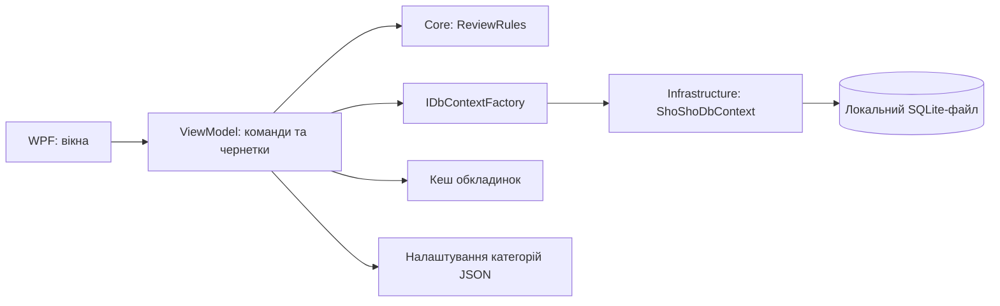
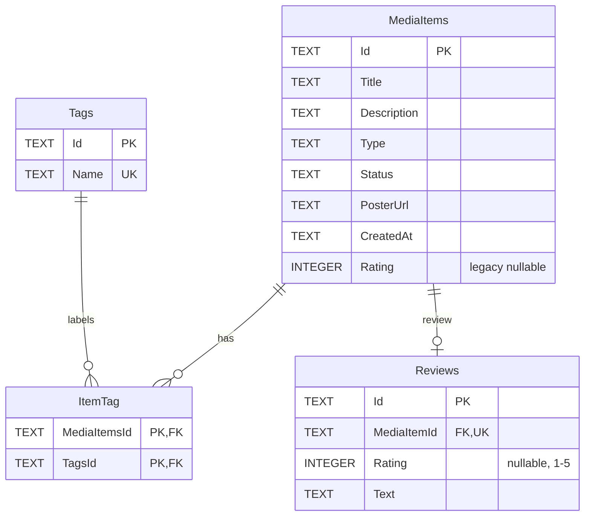

# Архітектура та модель даних ShoSho

Актуалізовано 30.10.2026 за кодом. SQLite — свідоме рішення для локального Windows-застосунку. Початковий план PostgreSQL, окремих репозиторіїв і сервісів не є описом уже реалізованих компонентів.

## Архітектура

Застосунок використовує .NET 10, WPF, CommunityToolkit.Mvvm та Entity Framework Core 10 з SQLite. Це багатошаровий десктопний моноліт без серверного API.

| Проєкт | Реалізована відповідальність |
| --- | --- |
| `ShoSho.Core` | Моделі `MediaItem`, `Tag`, `Review`, статуси та незалежні від WPF правила `ReviewRules`. |
| `ShoSho.Infrastructure` | `ShoShoDbContext`, конфігурація SQLite, зв’язки сутностей, UTC-перетворення дат, фабрика для EF CLI та міграції. |
| `ShoSho.UI` | Вікна WPF, команди й чернетки MVVM, запити через `IDbContextFactory<ShoShoDbContext>`, фільтри колекції, сортування, кеш обкладинок і збереження категорій. |

Залежності: UI → Infrastructure → Core; UI також використовує Core. Core не залежить від WPF або EF. Окремих `MediaRepository`, `TagRepository`, `MediaService`, `TagFilterEngine`, `StatusWorkflowManager` наразі немає. Винесення решти операцій із `MainViewModel` у прикладні сервіси залишається архітектурним завданням.

## Структура

```text
ShoSho.slnx
├── src/
│   ├── ShoSho.Core/
│   │   ├── Models/           # MediaItem, MediaStatus, Tag, Review
│   │   └── Services/         # ReviewRules
│   ├── ShoSho.Infrastructure/
│   │   ├── Data/             # DbContext і фабрика
│   │   └── Migrations/       # SQLite-міграції та snapshot
│   └── ShoSho.UI/
│       ├── *.xaml            # MainWindow, AddItemWindow, ItemDetailsWindow, CreateCategoryWindow
│       ├── ViewModels/       # MainViewModel, ItemDetailsViewModel
│       ├── Services/         # ImageCacheService
│       ├── CategoryStore.cs  # Локальні налаштування категорій
│       └── Assets/           # Заглушка обкладинки
├── tests/                   # SqliteSmoke та UiSmoke
└── docs/
```

## Потоки даних



При старті `App` реєструє фабрику контекстів і `MainViewModel` через DI. Ініціалізація застосовує міграції та завантажує записи з тегами й відгуками. HTTP-обкладинки кешуються локально; база зберігає вихідний URL. Пошук за назвою, статусом, категорією й тегами виконується над завантаженою WPF-колекцією. Для кількох обраних тегів використовується умова «усі теги».

Клік по картці відкриває деталі незалежно від статусу. Редагується окрема чернетка. «Зберегти» перевіряє дані, записує зміни через новий контекст і оновлює колекцію. Закриття без збереження відкидає чернетку. Видалення вимагає підтвердження користувача.

## SQLite та файли користувача

| Дані | Розташування за замовчуванням |
| --- | --- |
| Колекція | `%LOCALAPPDATA%\ShoSho\shosho.db` |
| Кеш HTTP-обкладинок | `%LOCALAPPDATA%\ShoSho\Cache` |
| Власні категорії та піктограми | `%APPDATA%\ShoSho\categories.json` |

Рядок підключення береться з `appsettings.json`; відносний шлях рахується від `%LOCALAPPDATA%\ShoSho`. Стандартний контекст і фабрика EF використовують те саме правило. Імпорту PostgreSQL-бази немає. Файл SQLite не зашифрований; доступ визначається правами Windows. Вбудованих облікових записів, токенів і синхронізації немає.

Запуск, публікація та резервні копії описані в [README](../README.md). Для відновлення категорій потрібен також `categories.json`; кеш можна завантажити повторно. Обкладинки, задані шляхами до власних файлів, потрібно копіювати окремо.

## Реляційна модель



- Назви таблиць: `MediaItems`, `Tags`, `ItemTag`, `Reviews`. Окремої таблиці `statuses` немає: статус — рядок зі значеннями, визначеними у Core.
- `Хочу` — віш-ліст, `Ін прогрес` — у процесі, `Вже всьо` — завершено, `Вагаюсі` — відкладено. Обов’язкового послідовного проходження статусів немає.
- `ItemTag` має складений первинний ключ. Назва тегу унікальна в БД; застосунок повторно використовує теги без урахування регістру, включно з українськими літерами.
- Для картки може існувати один відгук; унікальний індекс на `Reviews.MediaItemId` захищає цей зв’язок. Видалення картки каскадно видаляє відгук і зв’язки з тегами, але не спільні теги.
- Оцінка необов’язкова, ціла від **1 до 5**, а не 1–10. Створення/зміна оцінки й тексту дозволені для завершеного статусу. При поверненні до іншого статусу старий відгук залишається доступним для читання; його зміна потребує повторного вибору «Вже всьо».
- Ліміти форм: назва 255, опис/відгук 2000, URL 1000, тег 50 символів. Правила оцінювання перевіряє `ReviewRules`; SQLite сам по собі не забезпечує всі ці прикладні обмеження.
- GUID зберігаються як `TEXT`, оцінки — `INTEGER`, `CreatedAt` — UTC із перетворенням у контексті.

**Технічний борг:** `MediaItems.Rating` залишено для сумісності зі старими записами; основна оцінка — `Reviews.Rating`. Це дублювання означає, що вимога про єдине джерело оцінки ще не виконана. Прибирання потребує окремої міграції з перенесенням старих оцінок. Категорії зберігаються у JSON, а не в окремій таблиці.

## Рішення та межі перевірки

SQLite усуває потребу в сервері та мережевому доступі до колекції. EF Core відповідає за відстеження змін і міграції. MVVM використовується для команд і стану форм, але показ деяких діалогів та частина валідації ще містяться у WPF-коді.

`SqliteSmoke` та `UiSmoke` використовують тимчасові бази. Ці перевірки не підтверджують повне DPI-тестування, навантажувальне тестування, готовність інсталятора або реалізацію авторизації. Стан вимог зафіксовано в [аудиті відповідності](compliance-audit.md).
